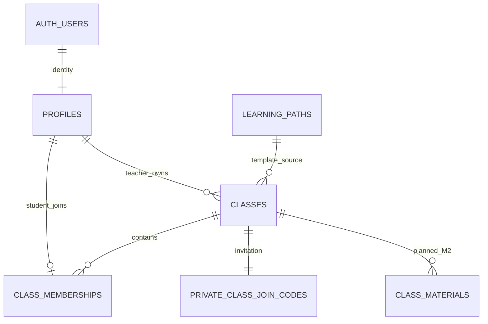

# Rencana perubahan database dan integrasi mobile

Tanggal: 2 November 2026. Berdasarkan [audit aktual Supabase](SUPABASE-DATABASE-AUDIT.md) dan [PRD mobile](PRD-MOBILE-REACT-NATIVE.md). **Status: paket akun/profil/kelas/avatar M1 sudah diterapkan melalui empat migrasi mobile.** Dokumen ini menyimpan rancangan dan alasan perubahan; nama/signature final serta hasil uji ada pada [kontrak aktual](API-CONTRACT-DRAFT.md) dan [laporan implementasi](M1-IMPLEMENTATION-VERIFICATION.md). Bagian setelah M1 tetap terencana.

## Pilihan arsitektur

Gunakan database Supabase yang terhubung, Supabase Auth sebagai pemilik akun/session, dan role aplikasi yang disimpan pada baris profil yang dilindungi. Kebutuhan mobile menentukan perubahan. Materi standar yang sudah ada menjadi sumber awal; Guru mengelola salinan kelasnya.

Pertahankan USER dan ADMIN yang ada. Tambahkan TEACHER tanpa mengubah arti data lama. Adapter mobile memetakan USER → student, TEACHER → teacher; ADMIN tidak mendapatkan shell operasional mobile. Pemeriksaan izin menggunakan role dari database, bukan user_metadata atau pilihan pada form.

## Bentuk data M1

| Objek | Field dan constraint usulan | Aturan |
|---|---|---|
| `profiles` (perluasan) | id/role/display_name yang ada; tambah nim text nullable, avatar_path text nullable, birth_date date nullable | Nama nonkosong wajib sebelum join; NIM nonkosong wajib bagi USER; foto/DOB opsional; role tidak dapat diubah lewat operasi profil |
| `classes` (baru) | id uuid PK, teacher_id uuid FK profiles, name text, source_learning_path_id uuid FK learning_paths, status active/archived, created_at/updated_at timestamptz, archived_at nullable | Pembuat harus TEACHER; pemilik berasal dari auth.uid(), bukan teacher_id kiriman client; arsip menolak mutasi kelas |
| `class_memberships` (baru) | id uuid PK, class_id uuid FK classes, student_id uuid FK profiles, joined_at timestamptz; **UNIQUE(student_id)** | Satu Siswa satu membership pada cakupan awal; row tetap ada setelah kelas diarsipkan, sehingga join kelas baru tetap ditolak |
| `private.class_join_codes` (baru) | class_id uuid PK/FK classes, code text UNIQUE, created_at timestamptz | Schema tidak diekspos Data API; kode hanya dikembalikan ke Guru pemilik melalui operasi terotorisasi |
| Storage avatar | Bucket privat, object path berawalan accountId | Pengguna hanya mengunggah fotonya; profil menyimpan path, bukan signed URL yang kadaluwarsa |

Kolom profil baru tetap nullable saat migrasi awal karena pendaftaran Auth membuat profil sebelum onboarding selesai dan akun lama belum memiliki NIM. `profileComplete` dihitung server dari role dan field; bukan boolean yang boleh ditetapkan client. NIM memakai text agar angka nol di depan tidak hilang. Keunikan NIM global belum diputuskan dalam PRD dan tidak ditambahkan sebagai asumsi.

Constraint kelas memasangkan status dan archived_at secara konsisten. Membership tidak dihapus oleh siswa. Perubahan role ke TEACHER untuk akun yang sudah menjadi siswa perlu ditolak/dikelola lewat administrasi terpisah; alur awal membuat akun Guru baru melalui Admin.

Indeks minimum: classes(teacher_id, created_at), class_memberships(class_id, joined_at). PK dan UNIQUE student_id/code menyediakan indeks untuk lookup terkait. Semua FK baru diperiksa kebutuhan indeksnya. Tidak ada cascade delete kelas sebagai pengganti arsip; akun/kelas dengan histori perlu kebijakan penghapusan tersendiri.

Relasi diagram tidak membuktikan role; validasi TEACHER/USER tetap dilakukan server. `CLASS_MATERIALS` merupakan rencana M2, belum ada pada schema saat ini.

## Operasi atomik bergabung kelas

1. Validasi sesi, role USER, nama/NIM, serta format kode. Terapkan rate limit pencarian kode.
2. Resolusi kode hanya mengembalikan ringkasan kelas aktif dan nama Guru untuk konfirmasi, tanpa roster, NIM, email, atau kode kelas lain.
3. Saat join, periksa ulang kode dan status. Lock row kelas agar join dan arsip tidak saling melewati pemeriksaan.
4. Buat membership dalam satu transaksi. UNIQUE(student_id) mencegah dua request bersamaan masuk ke dua kelas.
5. Retry join ke kelas yang sama mengembalikan membership yang sama. Membership ke kelas berbeda menghasilkan ALREADY_JOINED; kelas arsip menghasilkan CLASS_ARCHIVED.
6. Guru mengarsipkan kelas memakai lock yang sama. Setelah arsip tersimpan, tidak ada join/mutasi kelas baru yang boleh berhasil.

Kode menggunakan nilai acak dengan entropi memadai, bukan nomor kelas berurutan. Resolusi memiliki respons generik untuk kode salah/tidak tersedia. Nilai batas rate limit ditetapkan sebagai konfigurasi layanan saat implementasi, bukan angka tersembunyi dalam UI.

## Model akses M1

| Resource | Siswa | Guru | Penulisan |
|---|---|---|---|
| Profil privat | Diri sendiri | Diri sendiri; kebutuhan roster melalui proyeksi terbatas untuk kelas miliknya | Operasi update menerima hanya nama/NIM/foto/DOB; tidak menerima role/id |
| Identitas forum | Proyeksi id dan nama | Proyeksi id dan nama | PII profil tidak ikut JOIN/proyeksi forum |
| Kelas | Kelas yang diikuti | Kelas miliknya | Guru pemilik; status arsip diperiksa dalam transaksi |
| Membership | Membership sendiri | Daftar siswa kelas miliknya, field minimum | Hanya operasi join yang tervalidasi; tidak ada INSERT langsung dari client |
| Kode join | Tidak dapat membaca daftar kode | Kode kelas miliknya melalui operasi khusus | Dibuat/reset server sesuai pemilik dan status |
| Foto | Upload/read foto sendiri; akses tampilan foto orang lain hanya sesuai kebutuhan yang disetujui | Sama | Storage policy sesuai accountId, jenis dan ukuran file |

RLS dan ACL harus diterapkan bersama. SELECT own-profile yang ada tidak diubah menjadi SELECT semua profil hanya untuk menampilkan nama penulis forum. Guru tidak memperoleh SELECT global ke email/NIM/tanggal lahir seluruh pengguna.

RPC public memakai SECURITY INVOKER sejauh memungkinkan. Operasi yang memerlukan hak tambahan menggunakan implementasi SECURITY DEFINER di schema `private`, search_path tetap/kosong, auth.uid() wajib, dan grant EXECUTE spesifik. Wrapper public tidak boleh menjadi jalur untuk menjalankan SQL bebas. Identitas pemanggil tidak diterima sebagai parameter yang dipercaya.

Tidak memberikan grant INSERT/UPDATE langsung pada membership dan kode privat. Untuk update profil, pilih satu jalur yang jelas: RPC field-whitelist dengan role terlindungi. Jangan mengandalkan WITH CHECK(id=auth.uid()) saja karena itu tidak membatasi kolom role. JWT user_metadata tidak digunakan untuk otorisasi.

## Materi, tes, dan absensi setelah M1

- **Materi kelas (M2):** `class_materials` memuat class_id, source_lesson_id nullable, versi, urutan, judul, konten dan kebutuhan Lab. Salin materi standar saat provisioning kelas; perubahan Guru tidak menulis balik ke katalog global. Tambahkan lampiran bertipe PDF/video dengan locator tervalidasi. Progres mobile mengacu ke id materi kelas, bukan hanya id lesson global.
- **Akses materi (M2):** server memeriksa membership, status kelas, pretest, serta materi/Lab sebelumnya. Materi arsip yang menjadi hak anggota tetap dapat dibaca. Audit ulang policy katalog/RPC lama sebelum rollout; siswa tidak boleh melewati penguncian materi kelas melalui view atau id template. Jika katalog dipertahankan sebagai konten publik, tetapkan secara eksplisit mana yang benar-benar preview publik dan pisahkan dari konten kelas terkunci. Pengetatan policy bersama perlu memperhitungkan konsumen layanan lama, tanpa mengubah alur mobile agar mengikuti keterbatasannya.
- **Tes (M2):** konfigurasi per kelas dengan kind PRETEST/POSTTEST; attempt unik (class_id, student_id, kind), snapshot soal, starts_at/expires_at, state pengiriman dan revision jawaban. Perubahan soal tidak boleh menghindari unique attempt dengan mengganti assessment id. Gunakan server worker/scheduler atau finalisasi server yang andal untuk deadline saat app mati. Jangan hanya memperbarui fungsi lama yang menolak PRETEST tanpa menambahkan constraint/deadline.
- **Hasil (M2):** skor/pembahasan dirilis setelah submit; kunci tidak masuk payload soal. Nilai posttest tidak diterjemahkan menjadi passed. Penyimpanan hasil lama tidak otomatis menjadi kontrak hasil mobile.
- **Absensi (M3):** session per kelas dengan token, waktu dan status aktif; record unik (session_id, student_id), hasil validasi dan waktu server. Koreksi append-only menyimpan pelaku, alasan, sebelum/sesudah. Tidak ada kolom koordinat atau radius untuk absensi.
- **Forum/AI:** forum umum tetap lintas kelas. Guru memperoleh moderasi yang tervalidasi. Tes aktif/deadline dipakai konsisten oleh server forum dan AI. Secret provider tetap server-only sesuai [konfigurasi AI](AI-PROVIDER.md).

## Urutan perubahan yang dapat direview

| Paket | Isi | Bukti selesai sebelum lanjut |
|---|---|---|
| M1-DB-01 | Tambah TEACHER ke enum app_role | Migrasi terpisah selesai/commit sebelum enum baru digunakan dalam migrasi berikutnya |
| M1-DB-02 | Perluasan profil, onboarding/update field-whitelist, pembatasan privilege kolom | Signup tetap USER; percobaan menulis role ditolak; profil lama tetap terbaca |
| M1-DB-03 | Classes, membership, kode privat, RLS/ACL dan indeks | Dua siswa/dua Guru terisolasi; concurrent join dan join–archive mengikuti aturan |
| M1-API-01 | RPC resolusi/join/kelas/roster/dashboard dan konfigurasi Auth redirect | Kontrak aktual dan uji respons validasi/izin tersedia; tidak memerlukan secret server di APK |
| M1-ST-01 | Bucket avatar privat dan upload/read policy | Uji akses object lintas akun, ukuran/tipe, dan URL kedaluwarsa |
| M1-APP-01 | Supabase SDK, storage session aman, auth state dan login/daftar/reset | Restore/refresh/logout, konfirmasi email dan callback Android bekerja |
| M1-APP-02 | Onboarding profil, join, shell role dan beranda | Alur akun nyata selesai tanpa kelas/nilai fiktif; siswa baru diarahkan ke pretest yang belum dimulai |
| M2-DB/API | Materi kelas, penilaian, runner SQL dan deadline | Uji prasyarat/sekali tes/arsip/privasi kunci sebelum membuka reader penuh |

M1 dashboard boleh mengembalikan state `pretest_not_started` dan progres/nilai null ketika M2 belum dibangun. Jangan menganggap pretest selesai hanya agar demo dapat membuka materi.

Workflow migrasi remote yang ditemukan bersifat imperative (42 entri). Repo mobile belum memiliki baseline schema atau konfigurasi Supabase lokal. Sebelum menerapkan paket di atas: buat baseline yang bisa direproduksi dari project, tetapkan lokasi migrasi kanonis untuk database bersama, buat migrasi dengan CLI, dan uji secara lokal dengan data sintetis. Jangan mengulang seluruh seed lama ke remote atau menganggap metadata rows=0 berarti database kosong. Branch berbayar bukan prasyarat audit ini.

## Uji penerimaan yang harus ditambahkan saat implementasi

- Self-signup dengan metadata role=TEACHER/ADMIN tetap menghasilkan USER.
- USER tidak dapat mengubah role melalui update profil, REST langsung, atau RPC.
- Profil belum lengkap tidak dapat join; Guru tidak dapat join sebagai Siswa.
- Siswa A tidak membaca profil privat, kelas, membership, nilai atau lampiran Siswa B di kelas lain.
- Guru A tidak membuat perubahan atau membaca roster privat kelas Guru B.
- Dua join bersamaan: hanya satu kelas tercatat; retry kelas yang sama berhasil idempoten.
- Join pada kelas arsip ditolak; histori anggota tetap ada; mutasi Guru pada arsip ditolak.
- Foto/PDF kelas lain ditolak melalui URL/path langsung, bukan hanya disembunyikan di UI.
- Tidak ada grant/policy/endpoint yang mengizinkan siswa mengisi skor atau memalsukan progres.
- Uji Data API memakai publishable key + JWT user, bukan hanya koneksi postgres/MCP yang berprivilege.

Auth email confirmation, SMTP, Site URL, redirect allowlist, publishable key, dan setting exposed schemas masih perlu diverifikasi saat M1 dihubungkan. Audit sekarang cukup untuk menetapkan paket perubahan; belum merupakan persetujuan bahwa semua endpoint ini sudah tersedia.

## Absensi QR — diterapkan 3 November 2026

Migrasi `20261103103555_mobile_attendance.sql` menambah empat tabel privat untuk sesi, hash token, catatan unik siswa/sesi dan audit koreksi. Tidak ada kolom koordinat/radius. Wrapper `public.mobile_attendance` membatasi akses melalui RPC; kelas arsip hanya baca. Token maksimal 45 detik, rotasi klien sekitar 20 detik; detail kontrak, pengujian dan batas kamera ada di [implementasi absensi](ATTENDANCE-IMPLEMENTATION.md). Item offline/notifikasi tetap direncanakan.
